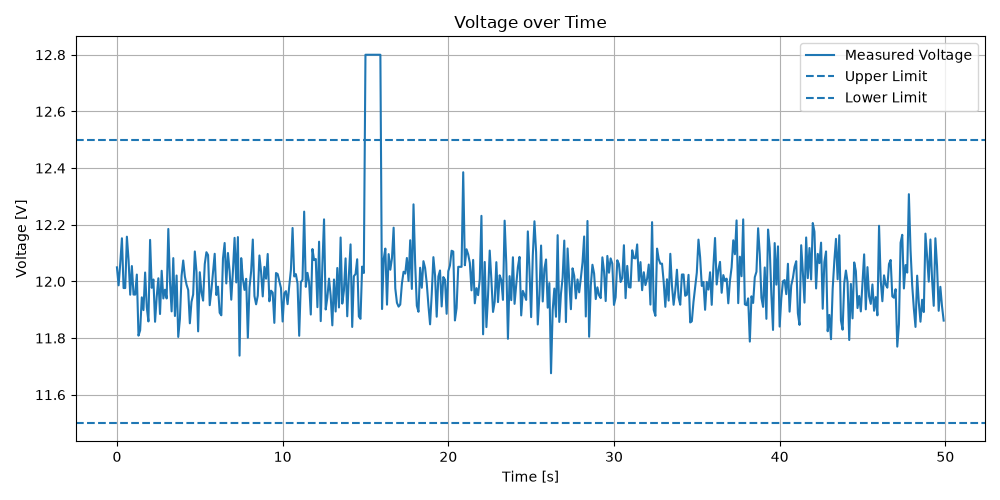
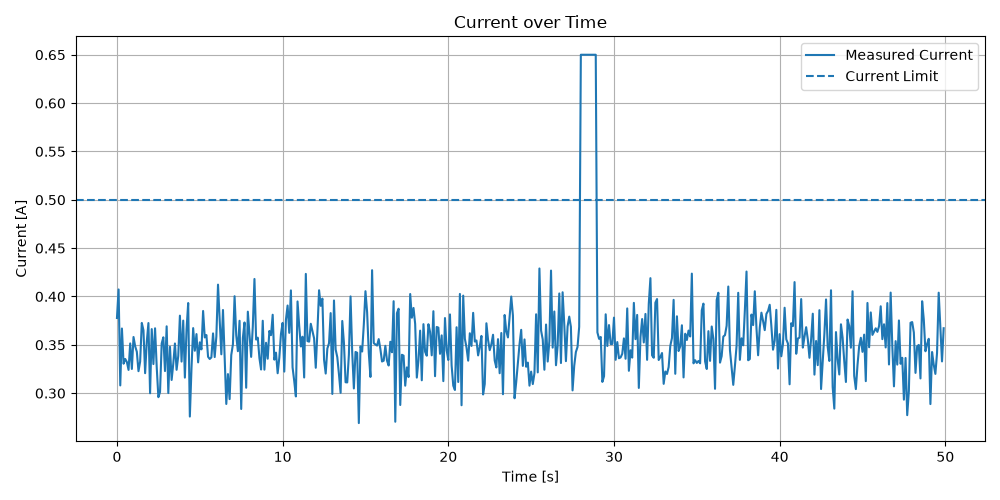
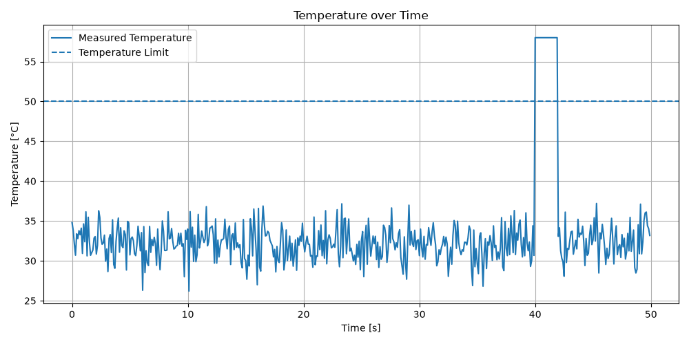

# Automated Test Validation Framework
[](https://github.com/FiveGum96/automated-test-validation-framework/actions/workflows/tests.yml)

A Python-based framework for automated validation of simulated technical measurement data.

The project demonstrates a structured test engineering workflow including requirements definition, test case creation, automated PASS/FAIL evaluation, fault detection, data visualization, report generation, and automated software testing.

## Main Features

- Generation of simulated measurement data
- Requirements-based test cases
- Automated limit checking
- PASS/FAIL classification
- Detection of limit violations
- Identification of violation periods
- Measurement data visualization
- Automated Excel report generation
- Automated PDF test report generation
- Unit testing with pytest
- Version control with Git

## Example Requirements

| Requirement | Description |
|---|---|
| REQ-001 | Voltage shall remain between 11.5 V and 12.5 V |
| REQ-002 | Current shall not exceed 0.50 A |
| REQ-003 | Temperature shall not exceed 50 °C |

## Example Output

### Voltage Validation



### Current Validation



### Temperature Validation



## Example Reports

- [PDF Test Report](reports/test_report.pdf)
- [Excel Test Report](reports/test_report.xlsx)

## Automated Tests

The validation logic is tested with pytest.

Current result:

```text
11 passed